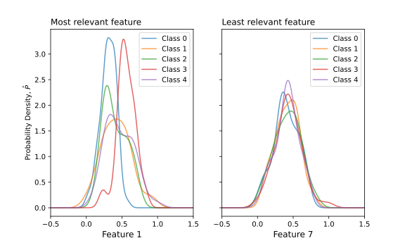
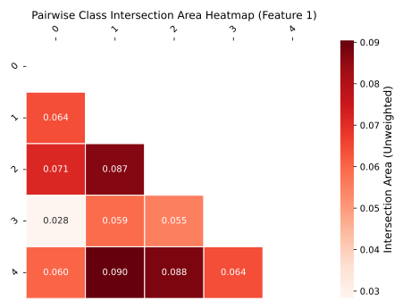

# **ProD**, a visualizable filter-feature selection method based on "prodding" the class {Pro}bability {D}ensities for overlapping.

## Install
ProD can be installed from PyPI:
<pre>
pip install prod-fs
</pre>

## Example
As an example, let's take a dummy dataset with 300 samples with 50 features, and 5 classes.
```python
from prod_fs import ProD

import numpy as np
import matplotlib.pyplot as plt
from sklearn.datasets import make_classification

# Create random classification dataset
X, y = make_classification(
    n_samples=300, n_features=50, n_classes=5, n_informative=5,
    shuffle=False, random_state=0
)
```

We then initialize the feature ranker, ProD, and carry out feature selection.

The hyperparameter `k` denote the number of classes in each subset when calculating the intersection areas. The default of `k=2` imply pairwise combinations. Specifically, the intersection areas are computed between pairs of classes 0-1, 0-2, 0-3, 0-4, 1-4, and so on. 

Subsequently, the average of the respective intersection areas of all pairwise combinations is used to rank the features from most to least relevant.
```python
# Initialize ProD object
prodRanker = ProD(k=2)

# Carry out feature selection
prodRanker.fit(X, y)
```

We then get the feature ranking, returned as a list. For this example, Feature 1 is the top ranked feature, followed by Feature 6, 4, 5, and so on.
```python
# Get feature rankings
feature_ranks = prodRanker.get_topnFeatures(50)

print(feature_ranks)
print(type(feature_ranks))
```
```
[1, 6, 4, 5, 0, 3, 2, 32, 43, 9, 13, 31, 48, 33, 20, 18, 10, 29, 44, 16, 11, 49, 17, 45, 12, 36, 46, 42, 37, 39, 38, 8, 40, 22, 27, 23, 41, 26, 30, 47, 35, 28, 15, 14, 25, 34, 24, 21, 19, 7]
<class 'list'>
```

To better understand and "visualize" a feature's relevance, we can plot the underlying probability distribution estimates.
```python
# Visualize the top feature's ability to segregate PDEs
fig, axs = plt.subplots(1, 2, figsize=(8.0, 4.8), sharey=True)

# Top ranked feature
prodRanker.plot_overlapAreas(top10Features[0], legend="class", _ax=axs[0], intersection_area=False)
axs[0].set_title("Most relevant feature", loc="left")

# Last ranked feature
prodRanker.plot_overlapAreas(49, legend="class", _ax=axs[1], intersection_area=False)
axs[1].set_title("Least relevant feature", loc="left")

axs[0].set_ylabel(r"Probability Density, $\hat{P}$")
for i in range(2):
    axs[i].set_xlim(-0.5, 1.5)
    axs[i].set_xticks(np.arange(-0.5, 2.0, 0.5))
```
<p align="center">
  
</p>

Features exhibiting a smaller intersection area are preferred over those with larger areas, as they indicate a better ability at segregating the different classes from one another and are therefore ranked higher. On the contrary, features that exhibit large intersection areas indicate the feature's inability to distinguish the classes from one another.

Here, the best ranked feature (Feature 1), is able to at least sufficiently segregate the blue and red classes from one another. On the contrary, the lowest ranked feature (Feature 7) is unable to segregate any classes from one another at all. Namely, the underlying distribution of all classes appear almost identical.

Since the features were ranked based on the computed average intersection area of all pairwise combinations, this thereby runs the risk of missing potential "failure cases". To identify such cases, one can also plot a heatmap displaying all the calculated pairwise intersection areas.
```python
# Plot a heat map to investigate the pairwise class intersection areas
fig, ax = plt.subplots(1, 1)
prodRanker.plot_classPairHeatmaps(feature_ranks[0], _ax=ax)
```
<p align="center">
  
</p>

As expected classes 1 (orange) and 4 (purple) exhibit a high intersection area (0.09). In a hypothetical case, where all other features exhibit small intersection areas, the average could falsely paint an overoptimistic picture by overlooking two classes with high overlapping areas.

One could potentially instead experiment with setting the hyperparameter `k` to the total number of classes as discussed in our paper.

## Citation

If you use `prod-fs` in your research, please cite our paper:

> J.C. Liaw, F. Geu Flores, W. Kowalczyk. ProD: A visualizable filter-feature selection method based on “prodding” the class {Pro}bability {D}ensities for overlapping. Machine Learning with Applications 26, 101035 (2026)

Here's an example of a BibTeX entry:

```bibtex
@article{liaw2026prod,
  title   = {{ProD: A visualizable filter-feature selection method based on “prodding” the class {Pro}bability {D}ensities for overlapping}},
  journal = {Machine Learning with Applications},
  volume  = {26},
  pages   = {101035},
  year    = {2026},
  issn    = {2666-8270},
  doi     = {10.1016/j.mlwa.2026.101035},
  url     = {https://doi.org/10.1016/j.mlwa.2026.101035},
  author  = {Liaw, Jin Cheng and {Geu Flores}, Francisco and Kowalczyk, Wojciech}
}
```
